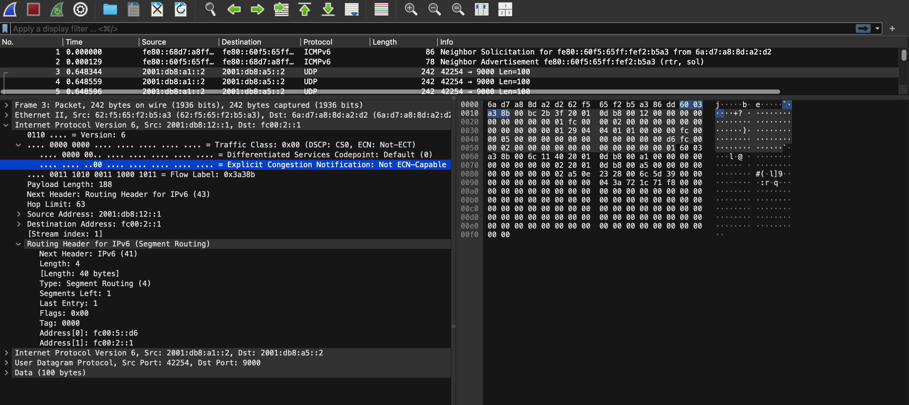
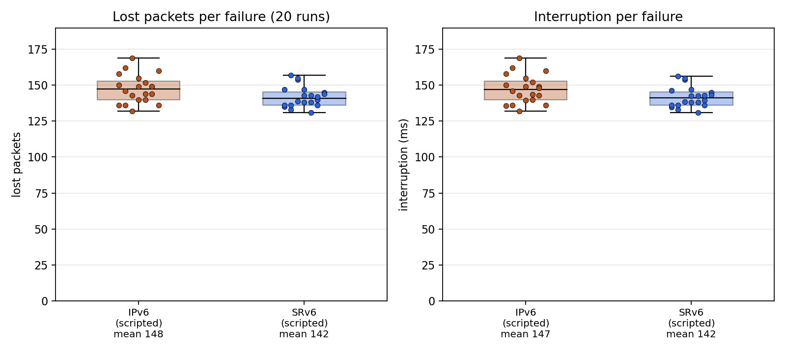
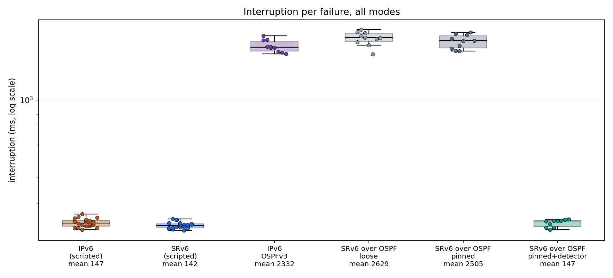
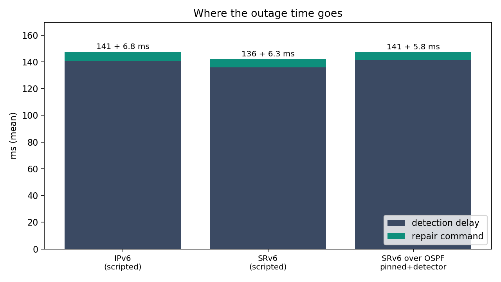

# SRv6 path steering and measured failure recovery: local testbed report

Author: Manash Roy

Course: <your course>    Date: 26 November 2026

## 1. Problem statement

In a normal IPv6 network each router picks the next hop on its own, so the path a packet takes
and how quickly traffic recovers after a link failure are both decided by the routing protocol.
Segment Routing over IPv6 (SRv6) lets the ingress router write an explicit list of segments (SIDs)
into the packet, so the path is chosen at the edge. This project asks whether SRv6 explicit path
steering behaves as specified on a small local testbed, and whether it changes how long traffic
is interrupted when a link fails, compared with ordinary IPv6 forwarding.

## 2. Objectives

Build a small SRv6 testbed (five routers, two explicit paths, one link failure) and compare
explicit SRv6 path steering with ordinary IPv6 forwarding under an identical topology and
failure scenario. Verify SID traversal in packet captures, and report loss, interruption time
and header overhead over repeated failures. A third, routing-protocol baseline (OSPFv3) shows how
the same failure is repaired when no scripted switch is used.

Specific objectives: build five routers with two explicit SRv6 paths (A: r1-r2-r5, B: r1-r3-r4-r5);
verify SID traversal and header overhead in packet captures; inject one link failure and measure
lost packets, interruption and detection delay over repeated runs; compare SRv6 with plain IPv6;
and, as stretch goals, test OSPFv3 underlay, real BFD and a local repair.

## 3. Design of the solution

### 3.1 Testbed

Seven Linux network namespaces (h1, r1-r5, h2) on an Ubuntu 24.04.5 VM (Multipass on an Apple
Silicon Mac; aarch64, kernel 6.8.0-147, 2 CPUs, 1.9 GiB RAM), joined by veth links. Tool versions: iproute2 6.1.0,
tcpdump 4.99.4, tshark 4.2.2, FRRouting 8.4.4, Python 3.12.3 (`results/config/environment.txt`). Full addressing, SIDs and policies are in `topology.md`; the configuration is built by
`scripts/setup.sh` and dumped per node in `results/config/` (FRRouting configs and running
configs for the OSPFv3 and overlay runs are in `results/config/frr/`).

- Primary path A: r1 -> r2 -> r5 (SRv6 segment list: fc00:2::1, fc00:5::d6; 2 SIDs)
- Backup path B: r1 -> r3 -> r4 -> r5 (segment list: fc00:3::1, fc00:4::1, fc00:5::d6; 3 SIDs)
- SIDs: End (fc00:N::1) on each router, End.DT6 (fc00:5::d6) on r5 for decapsulation.
- Compared modes: `ipv6` (plain route at r1) and `srv6` (H.Encaps policy at r1). Everything else
  (links, detector, failure, repair script) is identical.
- Third mode `ospf`: plain IPv6 with OSPFv3 (FRRouting 8.4.4, one instance per router) repairing the
  failure by itself, with no detector and no scripted switch (see section 4.4).

### 3.2 Method

- Traffic: h1 -> h2 UDP, 1000 packets/s, 100-byte payload, 6 s per run; each packet carries a
  sequence number and a timestamp (all clocks are the VM's CLOCK_MONOTONIC).
- Failure: at about 2.2 s into the traffic (measured 2.18-2.26 s after the first packet), 100 % loss is applied with `tc netem` to both ends of
  the r1-r2 link. The link stays administratively up (a silent failure).
- Detection: a BFD-like UDP prober on r1 sends a probe to r2 every 50 ms. After arming (5
  consecutive replies) it declares failure when 3 x 50 ms pass with no reply, measured from the
  last reply. This is **not real BFD** (no BFD protocol, no hardware offload).
- Repair: on detection the prober runs `scripts/set_policy.sh <mode>-backup`, which replaces the
  route at r1 with a single `ip route replace`.
- Metrics: lost packets (sent minus received); interruption (largest arrival gap minus the 1 ms
  send interval); detection delay (failure applied -> detector decision); repair time (decision ->
  switch command finished); restoration time (failure -> first packet after the interruption).
- Repetition: 20 failures per mode, alternating which mode runs first to cancel drift. Neighbour
  caches are warmed on both paths before each run. SID verification uses one extra, unmeasured
  run per mode with `tcpdump` on all seven link points.

## 4. Work completed

### 4.1 SID traversal and header overhead

Captured packets of the measured flow, per link (`results/sid_traversal.md`):

| Capture point | SRv6 outer destination (active SID) | Segments Left | SIDs in SRH |
|---|---|---|---|
| r1 -> r2 | fc00:2::1 | 1 | 2 |
| r2 -> r5 | fc00:5::d6 | 0 | 2 |
| r1 -> r3 | fc00:3::1 | 2 | 3 |
| r3 -> r4 | fc00:4::1 | 1 | 3 |
| r4 -> r5 | fc00:5::d6 | 0 | 3 |
| r5 -> h2 | plain IPv6 (decapsulated) | - | - |

Segments Left decreases at each End hop exactly as RFC 8754 describes, and r5 removes the outer
header. In `ipv6` mode no SRH appears at any point.

Packet conservation also holds: packets seen on r1-r2 plus r1-r3 equal packets arriving at h2
(IPv6 2265 + 3595 = 5860; SRv6 2254 + 3606 = 5860).

Header overhead (outer IPv6 40 B + SRH 8 B + 16 B per SID), measured from frame sizes:

| Path | SIDs | Measured | RFC 8754 expectation |
|---|---|---|---|
| A | 2 | 80 B (162 -> 242 B) | 80 B |
| B | 3 | 96 B (162 -> 258 B) | 96 B |

For the 100-byte payload used, this is 49 % and 59 % extra bytes per packet; the share shrinks
with larger payloads.

Independent cross-check: tshark (Wireshark 4.2) decoding of the same captures gives the same
destination SIDs, Segments Left and Last Entry values at every hop and the same packet counts (2254
on r1-r2 and r2-r5; 3606 on r1-r3, r3-r4 and r4-r5), and finds no routing header on r5-h2.

### 4.2 Path steering without a failure

Per-interface receive counters over 100 pings show each policy uses exactly the intended routers
(primary: r2 only; backup: r3 and r4 only), in both modes.

Path control test: the routes to h2's prefix were removed from r3 and r4.

| Policy | Delivered | Why |
|---|---|---|
| ipv6-backup | 0 / 100 | r3 has no route to the destination and drops the packets |
| srv6-backup | 100 / 100 | r3 and r4 only need the SIDs carried in the packet |

This is the clearest difference found between the two: SRv6 can steer through routers that hold no
forwarding state for the destination; plain IPv6 cannot.

`mtr -6 -n -r -c 8` (`scripts/mtr_check.sh`, `results/mtr.txt`) behaves the same: plain IPv6 shows
r1, r2, r5 and h2; the SRv6 policies show `???` (100 % loss) at the transit hops and h2 at hop 3 (path A)
or hop 4 (path B).

Traceroute shows every hop for plain IPv6 (r1, r2, r5, h2 over the primary path), but for SRv6 the
transit hops do not answer and h2 appears earlier (hop 3 instead of 4 on path A; hop 4 instead of 5
on path B). Captures of single probes (`scripts/traceroute_diag2.sh`, `traceroute_diag3.sh`, SRv6
policy `pinned-primary`) explain this:

| Probe hop limit | r1 -> r2 (outer header) | What happens |
|---|---|---|
| 1 | not seen | dropped at r1 without an ICMP error |
| 2 | hop limit 1 | outer hop limit expires at r2; r2 sends ICMPv6 time-exceeded to r1, the source of the outer header, not to h1; r1 does not relay it, so traceroute shows `*` |
| 3 | hop limit 2 (1 after r2) | reaches r5, which decapsulates; h2 receives the inner packet and answers |

The encapsulating router copies the (decremented) inner hop limit into the outer header, so a probe
expires inside the tunnel, and errors raised inside a tunnel go to its ingress router. Traceroute
therefore cannot show the SRv6 transit hops from the sending host; this is expected behaviour of
encapsulation mode, not a fault of the testbed. The path evidence remains the captures, the tshark
cross-check and the per-link counters. For plain IPv6 and for the OSPF underlay traceroute works as
usual.

### 4.3 Failure recovery with the scripted detector (20 runs per mode)

Mean +/- standard deviation (min-max):

| Metric | Plain IPv6 | SRv6 |
|---|---|---|
| Lost packets | 147.5 +/- 9.8 (132-169) | 142.0 +/- 7.3 (131-157) |
| Interruption (ms) | 147.4 +/- 9.9 | 141.8 +/- 7.2 |
| Detection delay (ms) | 140.8 +/- 8.9 (126-161) | 135.8 +/- 7.2 (125-150) |
| Repair command (ms) | 6.8 +/- 1.3 | 6.3 +/- 0.5 |
| Failure -> restored (ms) | 147.8 +/- 9.7 | 142.3 +/- 7.2 |

Plots (generated from `runs.csv` by `plot_results.py`; box = quartiles, dots = individual runs):

Findings:
1. About 95 % of the interruption is detection time; the policy switch itself takes 6-7 ms.
2. Measurements agree with each other: detection + repair matches interruption, which matches lost
   packets at 1000 packets/s.
3. The two modes show **no consistent difference**. SRv6 shows about 5 fewer lost packets (Welch
   t about 2.0, p about 0.05), but the gap sits entirely in the detection delay, which uses the same
   code in both modes, and an earlier run with an older detector showed no gap. It is treated as
   noise, not an SRv6 effect.

Scaling check (10 runs per mode, probes every 20 ms instead of 50 ms): detection 61.8 ms (IPv6) and
62.9 ms (SRv6), 68.2 and 69.2 lost packets. The interruption shrinks about in proportion to the detection
time, which supports the measurement chain.

### 4.4 Routing-protocol baseline (OSPFv3, 10 runs)

To compare with how plain IPv6 networks normally repair failures, a third mode runs OSPFv3
(FRRouting 8.4.4, one zebra + ospf6d per router, point-to-point links, hello 1 s, dead 3 s, no
detector and no scripted switch). OSPF learns the host prefixes itself (the static routes are
removed) and prefers the 2-hop primary path. Traffic and failure are the same, but runs last 10 s
because OSPF needs seconds. After each run the failure is cleared and OSPF must reconverge onto the
primary path before the next run (`ospf_experiment.py`, `results_ospf/`).

| Mode | Repair mechanism | Lost packets (mean) | Interruption (ms, mean) |
|---|---|---|---|
| Plain IPv6, scripted | detector + route switch | 147.5 +/- 9.8 | 147.4 |
| SRv6, scripted | same detector + switch | 142.0 +/- 7.3 | 141.8 |
| Plain IPv6, OSPFv3 (hello 1 s, dead 3 s) | routing protocol | 2331.7 +/- 223.4 (2064-2737) | 2331.6 +/- 223.2 (2064-2736) |

Findings:
1. The OSPF interruption is about 16 times longer. OSPF declares a neighbour dead only after the dead
   interval (3 s) passes without hellos, counted from the last hello received (hence 2.1-2.7 s),
   then recomputes the path and installs the route. The scripted detector needs about 150 ms.
2. This difference comes from the repair mechanism and its timers, **not** from SRv6 or from the
   forwarding method. With OSPF's default timers (hello 10 s, dead 40 s) the interruption is about 34 s
   (section 4.10). Real networks shorten routing-protocol repair with BFD, which is measured in
   section 4.7.
3. Loss percentages are not comparable between rows because the OSPF runs were 10 s long and the
   others 6 s; compare packets and milliseconds.
4. This holds for a silent failure. With a real link-down OSPF repairs in about 12 ms (section 4.6).

### 4.5 SRv6 overlay on an OSPFv3 underlay (10 runs per mode)

The realistic deployment: OSPFv3 carries reachability, including the SID locators fc00:N::/32
(each router advertises its locator from the `sid0` interface), and SRv6 policies at r1 steer
traffic over it. A policy is a /65 route covering h2, so it wins over OSPF's /64 by longest-prefix
match. Same traffic and failure as before, runs of 10 s, OSPF hello 1 s / dead 3 s
(`scripts/overlay_up.sh`, `overlay_experiment.py`, `results_overlay/`).

Policy definitions (`scripts/set_overlay.sh`, run inside r1). Each policy installs one route for
2001:db8:a5::/65 at r1 and changes nothing in OSPFv3:

- `loose`: `ip -6 route replace 2001:db8:a5::/65 encap seg6 mode encap segs fc00:5::d6 dev to2`.
  One SID; OSPFv3 decides how the packet reaches r5.
- `pinned-primary`: the same command with `segs fc00:2::1,fc00:5::d6 dev to2`. "Pinned" means the
  segment list forces the path through r2's End SID. It is an SRv6 setting at r1, not an OSPF setting.
- `pinned-backup`: `segs fc00:3::1,fc00:4::1,fc00:5::d6 dev to3`.
- `protected`: `pinned-primary` at metric 10 and `pinned-backup` at metric 20 together, with
  `ignore_routes_with_linkdown=1` on `to2` (section 4.8).
- `off`: no /65 route; traffic follows OSPFv3's /64 route (plain IPv6).

The OSPFv3 configuration is identical in every mode. It comes only from `scripts/ospf_up.sh` (area
0.0.0.0, `ipv6 ospf6 network point-to-point`, `ipv6 ospf6 hello-interval` and `dead-interval` on
the core links, `ipv6 ospf6 passive` on the host links) and `scripts/overlay_up.sh` (interface `sid0`
added to area 0 as passive, so each locator fc00:N::/32 is advertised). BFD is added by
`scripts/bfd_up.sh` or `scripts/bfd_all.sh` (`ipv6 ospf6 bfd profile fast`), and the default timers
by `overlay_defaulttimers.py`.

| Mode | Repair | Lost packets | Interruption (ms) |
|---|---|---|---|
| `overlay_loose` (one SID, fc00:5::d6) | OSPF only | 2629.7 +/- 281.0 (2046-3008) | 2629.4 +/- 281.1 |
| `overlay_pinned` (fc00:2::1, fc00:5::d6) | OSPF only | 2505.2 +/- 272.2 (2158-2885) | 2505.0 +/- 272.3 |
| `overlay_pinned_fast` (pinned + detector, backup via r3, r4) | detector switches policy | 147.3 +/- 8.4 (133-156) | 146.9 +/- 8.6 |

For `overlay_pinned_fast` detection took 141.4 +/- 8.7 ms and the policy switch 5.8 +/- 0.2 ms.

Findings:
1. Without a fast detector, the overlay changes nothing: recovery follows OSPF's dead interval
   (about 2.5-2.6 s), the same order as the plain OSPFv3 row in 4.4.
2. `overlay_loose` and `overlay_pinned` do not differ beyond noise (difference 124 packets, about
   one standard error; Welch t about 1.0).
3. With the BFD-like detector and a scripted switch to the explicit backup path, the interruption is
   about 147 ms, roughly 17-18 times shorter than OSPF alone, and the same as the scripted modes
   in section 4.3 (142-148 ms). The OSPF underlay did not slow the repair and the overlay did not
   speed it up: the detector sets the recovery time.
4. This shows that an SRv6 policy with fast local detection can repair long before the
   underlay protocol converges. It is a result about the combination, not an advantage of SRv6
   itself: plain IPv6 with the same detector and a scripted route switch recovers equally fast
   (section 4.3). SRv6's own contribution is the explicit path (section 4.2).

### 4.6 Real link-down failure (carrier loss, 10 runs per mode)

The project brief asks for a link brought down by script. Sections 4.3 to 4.5 used a silent
failure (100 % packet loss, link still up). Here r2's interface `to1` is set administratively down,
so r1 loses carrier and FRRouting sees the interface event immediately (`overlay_linkdown.py`,
`results_linkdown/`; same OSPFv3 underlay and SRv6 overlay as 4.5, plus `overlay_off` = plain IPv6
over OSPFv3 with no SRv6 policy; IPv6 addresses are kept on link-down with `keep_addr_on_down`).

| Mode | Valid runs | Lost packets | Interruption, median (mean +/- sd) |
|---|---|---|---|
| `overlay_off` (plain IPv6, OSPFv3) | 10 | 11.4 +/- 0.5 (11-12) | 11.1 ms (13.5 +/- 7.8) |
| `overlay_loose` (SRv6, one SID) | 10 | 12.0 +/- 0.9 (11-14) | 11.5 ms (11.7 +/- 1.2) |
| `overlay_pinned` (SRv6 via r2) | 9 | 12.7 +/- 0.9 (12-14) | 12.3 ms (19.8 +/- 12.7) |
| `overlay_pinned_fast` (pinned + detector) | 9 | 12.7 +/- 1.1 (12-15) | 11.8 ms (12.7 +/- 2.1) |

For `overlay_pinned_fast` the detector fired 126.9 +/- 1.6 ms after the failure and the switch took
6.9 +/- 0.6 ms. Two runs (`overlay_pinned_006`, `overlay_pinned_fast_009`) were excluded by the
analysis because the largest arrival gap preceded the failure.

Findings:
1. Every mode loses about 11-13 packets (an interruption of roughly 11-13 ms), because FRRouting reacts
   to the carrier loss at once. Differences between modes are about one packet, within noise;
   pinning the path through r2 (traffic hairpins through r5 and r2 after the repair) costs nothing
   measurable.
2. The scripted detector is not useful here: it fires at 127 ms, after traffic is already restored
   (about 11 ms), so it adds no benefit and the policy switch happens after the repair.
3. The mean interruption and the "failure to restored" time are inflated in some runs by single
   arrival gaps of 35-46 ms at other moments of the run, with no extra packet loss (the lost-packet
   counts stay at 11-15): VM or receiver stalls, analysed in section 4.12. Medians and lost
   packets are the reliable figures for this table.
4. Taken with 4.4 and 4.5: the interruption is decided by how the failure is detected, not by SRv6. A
   silent failure takes OSPF about 2.3-2.6 s (dead interval) and a fast detector about 150 ms; a
   carrier-loss failure takes OSPF about 12 ms. The "OSPF is 16 times slower" figure in 4.4 applies
   to the silent failure only.

### 4.7 Real BFD registered with OSPFv3 (silent failure, 10 runs per mode)

FRRouting's `bfdd` runs in r1 and r2 (profile: 50 ms transmit and receive interval, detect
multiplier 3, the same timers as the scripted detector) and is registered with OSPFv3 on the r1-r2
link (`ipv6 ospf6 bfd profile fast`; `scripts/bfd_up.sh`). When BFD declares the session down, OSPF
drops the neighbour at once instead of waiting for its 3 s dead interval. Same silent failure and
overlay topology as 4.5 (`overlay_bfd.py`, `results_bfd/`; `overlay_off` = plain IPv6 over OSPFv3).

| Mode | Repair | Lost packets | Interruption (ms) |
|---|---|---|---|
| `overlay_off` (plain IPv6, OSPFv3 + BFD) | BFD -> OSPF | 145.4 +/- 16.4 (125-167) | 145.2 +/- 16.4 |
| `overlay_loose` (SRv6, one SID) | BFD -> OSPF | 153.4 +/- 23.1 (126-199) | 153.3 +/- 23.1 |
| `overlay_pinned` (SRv6 via r2) | BFD -> OSPF | 152.1 +/- 12.4 (133-177) | 151.9 +/- 12.6 |
| `overlay_pinned_fast` (pinned + scripted detector) | scripted switch | 139.4 +/- 14.6 (111-158) | 139.2 +/- 14.6 |

For `overlay_pinned_fast` the scripted detector fired 135.4 +/- 15.2 ms after the failure and the
switch took 7.9 +/- 1.3 ms.

Findings:
1. Real BFD brings OSPFv3 from about 2.3-2.6 s (4.4, 4.5) down to about 145 ms, roughly 16 times
   faster, with no scripted switch. The repair time is set by the BFD detection time (3 x 50 ms).
2. All four modes are within noise of each other (differences up to 14 packets against standard
   deviations of 12-23; Welch t against `overlay_off`: 0.9, 1.0 and -0.9). The scripted detector
   and real BFD give the same interruption, and SRv6 steering adds no measurable delay or gain.
3. Together with 4.4-4.6, the interruption is set by the failure-detection mechanism (silent failure:
   OSPF dead timer 2.3-2.6 s, BFD or scripted detector about 145 ms; link-down: about 12 ms), not
   by the forwarding method.

### 4.8 Pre-computed local repair at r1 (TI-LFA-like, link-down failure, 10 runs per mode)

Real TI-LFA could not be tested: FRRouting implements it for IS-IS with SR-MPLS, and the VM kernel
has no MPLS support. As a substitute, r1 holds the primary SRv6 policy (metric 10, via r2) and the
backup policy (metric 20, via r3 and r4) in its table at the same time, with
`ignore_routes_with_linkdown=1`. When the interface loses carrier, the kernel skips the dead primary
and uses the backup in the data plane, with no routing-protocol or script involvement
(`scripts/set_overlay.sh protected`, `overlay_localrepair.py`, `results_localrepair/`). The backup
is configured by hand, not computed, and no loop-freedom analysis is done, so this is not TI-LFA.
Failure: r2's interface set down, as in 4.6.

| Mode | Repair | Lost packets (mean +/- sd) | Per-run counts |
|---|---|---|---|
| `overlay_off` (plain IPv6, OSPFv3) | OSPF | 11.6 +/- 0.7 (11-13) | 12 11 12 13 11 12 12 11 11 11 |
| `overlay_pinned` (SRv6 via r2) | OSPF | 12.8 +/- 0.9 (12-15) | 15 13 13 12 12 13 13 12 13 12 |
| `overlay_protected` (SRv6, local repair) | kernel local repair | 0.3 +/- 0.5 (0-1) | 0 0 0 0 0 0 0 1 1 1 |

Lost packets were counted as sent minus received from the raw files for all 10 runs of each mode.
The interruption and restoration metrics of `analyze.py` are not usable for `overlay_protected`: the
repair is faster than the arrival-gap jitter of the VM, so 6 of 10 runs were excluded by the
analysis (largest gap precedes the failure) and its remaining restoration figure is meaningless.

Findings:
1. The local repair loses 0-1 packets (under 1 ms of interruption), against 11-13 packets (about 12 ms)
   when OSPF repairs after a link-down. In this setup, a pre-installed backup path removes the
   control-plane reaction time.
2. It only protects failures that the kernel sees as loss of carrier on the local interface. A
   silent failure (4.3, 4.4, 4.5, 4.7) is not covered, as the link keeps its carrier.
3. The result is about the repair mechanism (a pre-installed backup chosen by the kernel), not about
   SRv6 encapsulation; a plain IPv6 route pair with the same metrics would be repaired the same way.
   This was confirmed by the plain-IPv6 control in section 4.11.

### 4.9 Real BFD on every core link, and a failure on a remote link

`scripts/bfd_all.sh` runs bfdd (50 ms x 3, profile fast) in all five routers and registers it with
OSPFv3 on all five core links (10 sessions, all `up`; every router had 2 Full OSPF neighbours).
Two tests, 10 runs each (`overlay_bfd.py`, `overlay_remote.py`), silent failure (netem 100 % loss).

Failure on r1-r2 with BFD on all links (`results_bfd_all/`, mean +- sd of lost packets):

| Mode | valid runs | Lost packets |
|---|---|---|
| Plain IPv6 over OSPFv3 | 10 | 151.6 +- 13.5 |
| SRv6 loose (one SID) | 9 | 143.3 +- 15.4 |
| SRv6 pinned | 10 | 145.5 +- 19.6 |
| SRv6 pinned + scripted detector | 9 | 140.4 +- 10.8 |

Excluded: `overlay_loose_000` (no connectivity at the start of the run, almost no packets received)
and `overlay_pinned_fast_002` (the scripted detector fired before the failure; that run also
contains a 6.6 s interruption that I did not explain).

Failure on the remote link r2-r5 (on path A, not adjacent to r1), `results_remote_bfd/` (BFD on r2-r5)
and `results_remote_nobfd/` (BFD removed from r2-r5, OSPF dead timer only, hello 1 s / dead 3 s):

| r2-r5 failure | Mode | valid runs | Lost packets (mean +- sd) | median |
|---|---|---|---|---|
| BFD on r2-r5 | Plain IPv6 | 9 | 147.4 +- 19.0 | 136 |
| BFD on r2-r5 | SRv6 loose | 9 | 149.3 +- 20.2 | 156 |
| no BFD on r2-r5 | Plain IPv6 | 9 | 2418.2 +- 314 | 2228 |
| no BFD on r2-r5 | SRv6 loose | 9 | 2417.6 +- 322 | 2191 |

BFD on the failing link shortens the interruption from about 2.4 s to about 0.15 s (roughly 16 times).
BFD on r1-r2 alone could not have protected this failure. IPv6 and SRv6 behave the same. In the BFD-on
campaign the 10th plain-IPv6 run stopped with "OSPF did not return to the primary path", so that
campaign has 9 runs per mode. In the BFD-off campaign `remote_off_009` received 53 of 10,000 packets
(no connectivity before the failure) and `remote_loose_009` had its largest gap before the failure;
both are excluded. The likely cause is that the previous run's link had not settled; I did not prove it.

### 4.10 OSPFv3 with default timers (hello 10 s, dead 40 s)

`overlay_defaulttimers.py` sets hello 10 s / dead 40 s on all core links, removes BFD, runs a 55 s
silent r1-r2 failure and restores the 1 s / 3 s timers and BFD afterwards (`results_ospf_default/`, 5 runs per mode):

| Mode | Lost packets (mean +- sd) | Range | Interruption (ms) |
|---|---|---|---|
| Plain IPv6 | 34,118.8 +- 292 | 33,741-34,530 | 34,119 |
| SRv6 loose | 34,079.8 +- 178 | 33,900-34,313 | 34,080 |

The interruption is about 34 s for both, about 15 times the 1 s / 3 s result (2.3 s); the dead-interval ratio is
13.3. All ten runs fall between 33.7 and 34.5 s, which is tighter than the 30-40 s I expected from the hello
cycle, so I do not have a full explanation of the value. n = 5 per mode.

### 4.11 Local repair without SRv6 (control) and at 5,000 packets per second

`overlay_localrepair_plain.py` installs two plain IPv6 routes at r1 for the same destination range
(primary via r2 at metric 10, backup via r3 at metric 20, `ignore_routes_with_linkdown=1`, no SRH) and runs the
same link-down failure as the SRv6 `protected` mode, in the same session. The plain backup is loop-free on this
topology: r3's own route to the destination goes via r4 (`ip -n r3 -6 route show 2001:db8:a5::/64`), not back to r1.

| Probe rate | Mode | runs | Lost packets (mean) | Interruption (ms, mean +- sd) |
|---|---|---|---|---|
| 1,000 pps (`results_localrepair_plain/`) | Plain IPv6, local backup | 10 | 0.6 | 0.66 +- 0.81 |
| 1,000 pps | SRv6, local backup | 10 | 0.4 | 0.33 +- 0.67 |
| 5,000 pps (`results_lrp_5k_v2/`) | Plain IPv6, local backup | 10 | median 3 (1-6) | 0.46 +- 0.35 |
| 5,000 pps | SRv6, local backup | 10 | median 2.5 | 0.42 +- 0.20 |

The near-zero loss on link-down therefore comes from the pre-installed backup route and the kernel skipping
the dead route, not from SRv6. At 5,000 pps one packet is 0.2 ms, so the repair is about 0.4-0.5 ms.
One of the 10 SRv6 runs at 5,000 pps (`overlay_protected_004`) lost the backup path about 4.4 s after the
repair and received nothing for the rest of the run (21,595 packets lost). I do not know why; it happened once
in 10 SRv6 runs and not in the plain runs, which n = 10 cannot tell apart. The interruption column ignores
loss at the start or end of a run, so it is not affected; the lost-packet mean is, and the median is given instead.
An earlier 5,000 pps campaign (`results_lrp_5k_full/`) had four runs with connectivity faults at the start or in
the middle; I added a gate that requires 10 of 10 successful pings before every run, and the second campaign had none of the
start faults. The first campaign is kept as evidence only.

### 4.12 How interruption is measured, and arrival-gap stalls

Interruption is the largest arrival gap in which packets were lost, minus the nominal packet interval
(`tools/interruption_summary.py`); a run with no loss has interruption 0. `tools/gap_report.py` lists every gap over 10 ms.
In the link-down campaign (40 runs) there were 40 interruption gaps of 10.7-17.0 ms, starting about 1 ms before the
recorded failure time (so the receiver and the failure timestamps share a clock), and 12 gaps of 10-50 ms in which no
packet was lost (packets arrived late, in a burst); 3 more occurred before the failure was injected. These are VM or receiver
stalls, not interruptions. They explain why the mean of the previous "largest gap" metric was sometimes inflated. The rule
"gap containing the failure instant" is not used, because in a few runs the failure timestamp is taken after the
interruption has already ended (the `tc` or `ip` command returns late in the VM), so the lost-packet count and the loss-bearing gap are used.

### 4.13 Measured header overhead, including reduced encapsulation

`scripts/overhead_modes.sh` sends a 100-byte ping through r1 and decodes the frame with tshark on the first link
after r1 (frame sizes include the 14 B Ethernet header; a plain frame is 162 B).

| Configuration | Frame (B) | Added | Next headers | Theory |
|---|---|---|---|---|
| Plain IPv6 | 162 | 0 | 58 | - |
| `encap`, path A, 2 SIDs | 242 | 80 | 43, 58 | 80 |
| `encap.red`, path A, 2 SIDs | 226 | 64 | 43, 58 | 64 |
| `encap`, 1 SID | 226 | 64 | 43, 58 | 64 |
| `encap.red`, 1 SID | 202 | 40 | 41, 58 | 40 (no SRH) |
| `encap`, path B, 3 SIDs | 258 | 96 | 43, 58 | 96 |
| `encap.red`, path B, 3 SIDs | 242 | 80 | 43, 58 | 80 |

Reduced encapsulation (H.Encaps.Red) saves 16 B per packet when the segment list has more than one SID and
removes the SRH entirely for one SID. Only plain `encap` (full SRH) was used in the failure-recovery runs.

## 5. Limitations and work not completed

Limitations that remain:

- One VM with emulated links and injected loss; not a real network. Timings include scheduling jitter of about
  10 ms, and 12 stalls of 10-50 ms with no packet loss were seen in 40 link-down runs (section 4.12).
- The scripted-IPv6 versus SRv6 comparison (section 4.3, silent failure) uses a BFD-like detector and a static-route
  baseline. Real BFD (all five core links, section 4.9) and OSPFv3 with tuned and default timers (4.4, 4.10)
  are measured separately, so the conclusion does not depend on the scripted detector alone.
- Run counts are 20 per scripted mode, 10 for most other campaigns, and 5 for the default-timer campaign; several
  campaigns have 9 valid runs after excluding runs that started without connectivity (4.9, 4.11).
- Recovery was measured with full-SRH encapsulation only. Reduced encapsulation was measured for header overhead
  (4.13) but not for recovery; End.X, uSID and H.Insert were not tested.
- The local repair (4.8, 4.11) is hand-configured, covers carrier-loss failures only, and its loop-freedom was
  checked only by inspecting r3's route for this topology; there is no general analysis.
- Two failure types were tested: silent packet loss and link-down.
- Observed but not explained: the exact value of about 34 s with default OSPF timers; the 6.6 s interruption in
  `overlay_pinned_fast_002`; one SRv6 local-repair run that lost its backup path 4.4 s after the repair (4.11).
- The results show behaviour of this testbed only and do not show an operational advantage of SRv6.

### Work not completed

- TI-LFA: not possible in this environment, because FRRouting implements it for IS-IS with SR-MPLS and the
  VM kernel has no MPLS support. A hand-configured pre-computed local repair was tested instead (4.8, 4.11); it is not TI-LFA.
- A real multi-host network instead of one VM.

Mitigated since the first version: BFD now covers every core link (4.9) and a remote failure is measured; OSPF
default timers are measured (4.10); the local repair has a plain-IPv6 control (4.11); interruption is measured
with a rule that ignores stalls (4.12); header overhead is measured, including reduced encapsulation (4.13).

## 6. Challenges handled

- SID routes attached to `lo` were never matched for packets arriving on another interface (End
  action counter stayed at 0). Attaching them to a dummy interface (`sid0`) fixed it.
- The first detector counted missed probe windows and fired falsely under short timers. It was
  replaced with a last-reply timer plus an arming phase. Results from the first detector (about
  189 ms detection) are superseded and kept in `results_v1_old/` only for reference.
- In the idle VM, timers fired 60-95 ms late (measured with `tools/gapprobe.py`), so the detector
  is started after the traffic, which keeps the CPUs awake. Under traffic, reply gaps were at most
  33 ms. Timers below about 100 ms are not reliable in an idle VM.
- The analysis script now rejects runs where detection precedes the failure.
- Traceroute on SRv6 paths: transit hops were silent. Cause found with hop-limit captures (section 4.2):
  the outer header inherits the inner hop limit, probes expire inside the tunnel, and the ICMP errors
  return to the ingress router r1. Not a defect.
- FRRouting inside the namespaces: the daemons could not read their own config files, so the
  configuration is sent with `vtysh -f` after start-up; config blocks must be closed with `exit`
  (the `!` separator does not end a block when vtysh reads the file); the daemons need `root` in
  the `frrvty` group.
- Captured frame sizes were identical for every encapsulation mode in the first overhead run: the old capture
  file was being reused. Removing it before each capture and running tcpdump as root fixed it; the routes are now
  printed next to each size as proof.
- Some runs started with no working connectivity after the previous run's link flap. The local-repair control now
  requires 10 of 10 pings before each run; the remaining excluded runs are listed in sections 4.9 and 4.11.
- The failure timestamp is taken after the `tc` or `ip` command returns and can be late in the VM, so the interruption is
  measured as the largest loss-bearing gap, not as the gap containing the timestamp (section 4.12).
- A first overhead script assumed the capture saw the encapsulated packet; checking the printed route showed the
  policy was active, which is how the stale file was found.

## 7. Main observations and conclusions

### Main observations

1. SRv6 works as specified: SIDs are visited in order, Segments Left counts down, overhead is 80 B (path A) and 96 B (path B).
2. SRv6 reaches r3 and r4 even though they have no route to the destination; plain IPv6 does not (100/100 against 0/100 in the no-route test).
3. Recovery is the same for IPv6 and SRv6 with the same mechanism: silent failure 147.5 vs 142.0 lost packets (20 runs each).
4. Interruption depends on detection and repair: OSPFv3 with tuned timers (1 s / 3 s) about 2.3 to 2.6 s, with default timers (10 s / 40 s) about 34 s; scripted detector or real BFD about 145 ms; link-down about 12 ms; pre-installed local backup under 1 ms (about 0.4 ms at 5,000 pps).
5. BFD must run on the failing link: with BFD on every core link a failure on a remote link is repaired in about 150 ms, without it in about 2.4 s.
6. The local repair works the same without SRv6 (0.6 against 0.4 lost packets at 1,000 pps); it is TI-LFA-like only, and helps only when the link loses carrier.
7. Measured overhead matches the RFC calculation exactly (80, 96 B; 64, 80 B and 40 B with reduced encapsulation).

### Conclusions

SRv6 steering works as specified: the SRH carries the expected SIDs, Segments Left counts down per
hop, overhead matches RFC 8754 (80 B and 96 B), and packets traverse r3 and r4 even when those
routers have no route to the destination. With the same detector and repair mechanism, recovery
time and loss were the same for SRv6 and plain IPv6 within noise (about 140-148 ms interruption),
dominated by failure detection. A routing-protocol baseline (OSPFv3, hello 1 s / dead 3 s) took
about 2.3 s to repair the same failure, roughly 16 times longer, which again points at detection
time and not at the forwarding method. With SRv6 running over the OSPFv3 underlay, recovery was
still about 2.5 s unless the fast detector switched the policy, in which case it was about 147 ms. With a real link-down (carrier loss) every setup, including plain OSPFv3, recovered in about 12 ms, and the scripted detector (127 ms) was slower than the routing protocol. Real BFD (50 ms x 3) registered with OSPFv3 cut the silent-failure interruption to about 145 ms, the same as the scripted detector, with or without SRv6. The interruption is set by how the failure is detected, not by SRv6. A pre-installed local backup policy (TI-LFA-like, not TI-LFA) removed the interruption almost entirely (0.3 packets) when the link loses carrier, but does not help a silent failure. The control without SRv6 gave the same result (0.6 lost packets against 0.4), so that repair belongs to the pre-installed backup route, not to SRv6. Running BFD on every core link made a failure on a remote link repair in about 150 ms instead of about 2.4 s, and the OSPFv3 default timers (hello 10 s / dead 40 s) gave an interruption of about 34 s. Header overhead was measured and matches the RFC values, with reduced encapsulation saving 16 B per packet, or the whole SRH for a single SID. Several runs were excluded (listed in the sections above), and three observations are not explained (section 5).

## References

- RFC 8754, IPv6 Segment Routing Header (SRH): https://www.rfc-editor.org/rfc/rfc8754.html
- RFC 8986, Segment Routing over IPv6 (SRv6) Network Programming
